<p align="center">
  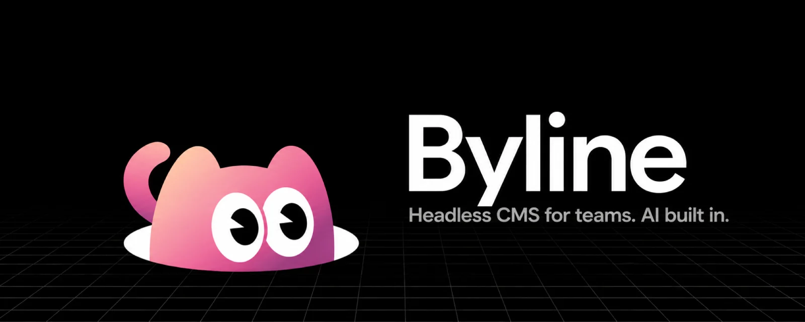
</p>

<p align="center">
  <a href="./LICENSE"></a>
  <a href="https://hub.docker.com/r/innei/byline"></a>
  <a href="https://www.npmjs.com/package/@mx-space/byline-api-client"></a>
</p>

<p align="center">
  Multi-author, API-only CMS. Derived from <a href="https://github.com/mx-space/core">Mix Space</a>.
  <br>
  🤖 Agents and LLMs: read <a href="./llms.txt"><code>llms.txt</code></a> for the full reference.
</p>

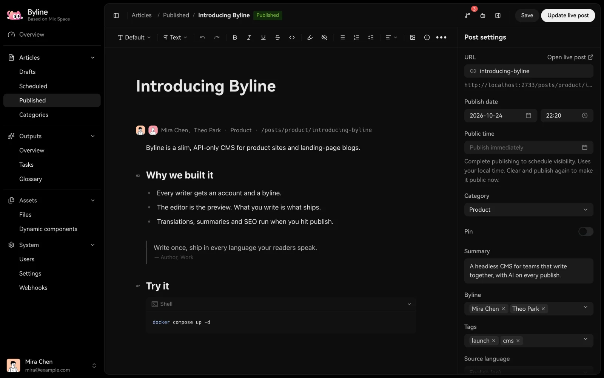

## Run

```sh
export JWT_SECRET="$(openssl rand -hex 32)"
docker compose up -d
open http://localhost:2333/admin/
```

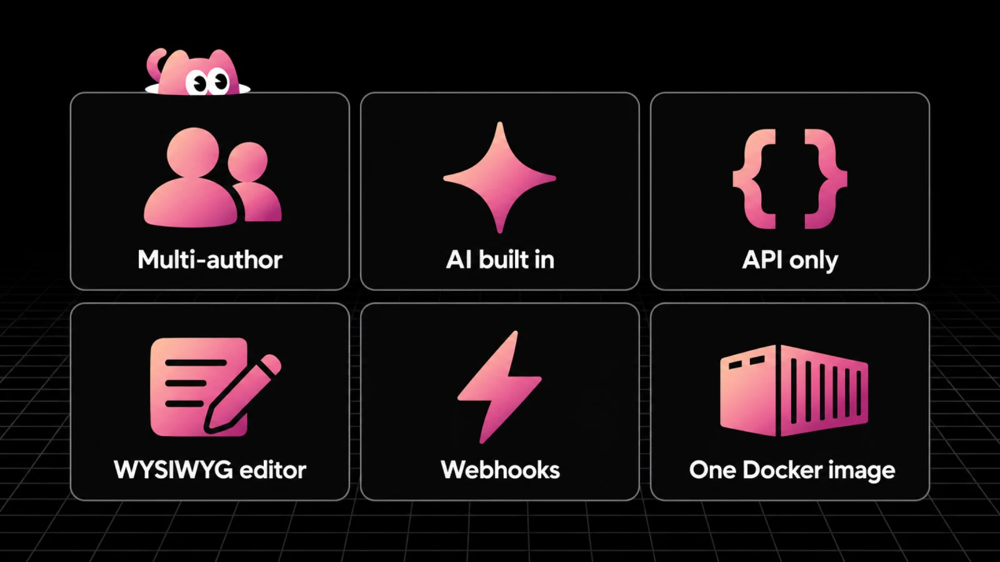

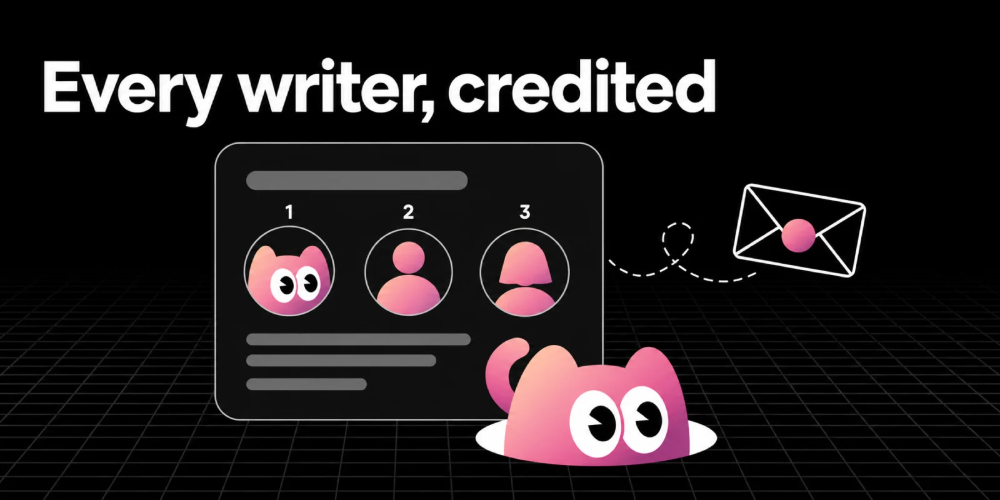

Ordered bylines. Invite-only accounts. Guest authors without a login.

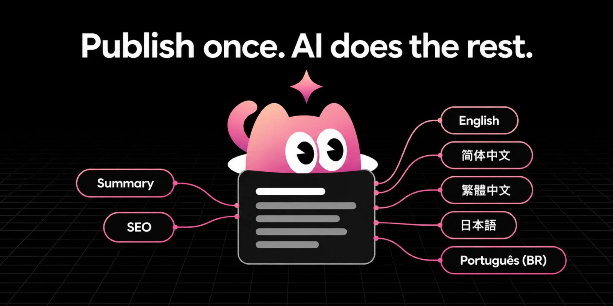

Translations, summaries and SEO descriptions run on publish. Hand-written translations stay locked.

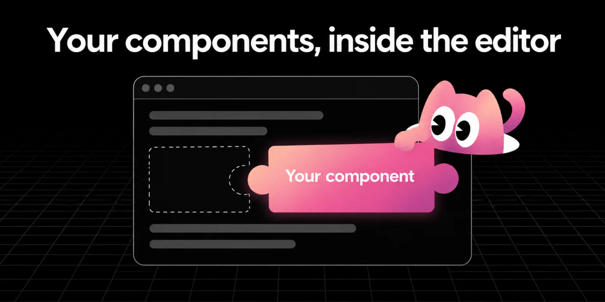

Site-specific blocks are haklex Dynamic Nodes: `{ url, props }`. Byline stores them; your site renders them.

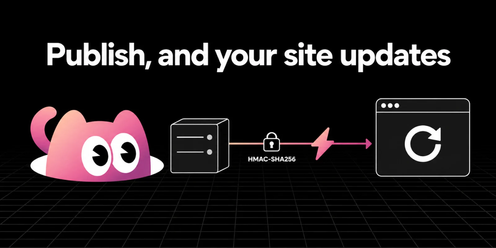

Signed webhooks with a replayable event log.

## How it fits

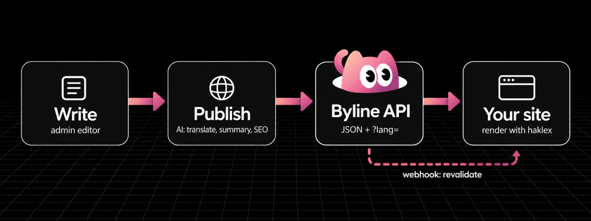

```sh
curl 'https://cms.example.com/api/v3/posts/slug/hello-world?lang=zh-CN'
```

## More screens

<table>
  <tr>
    <td>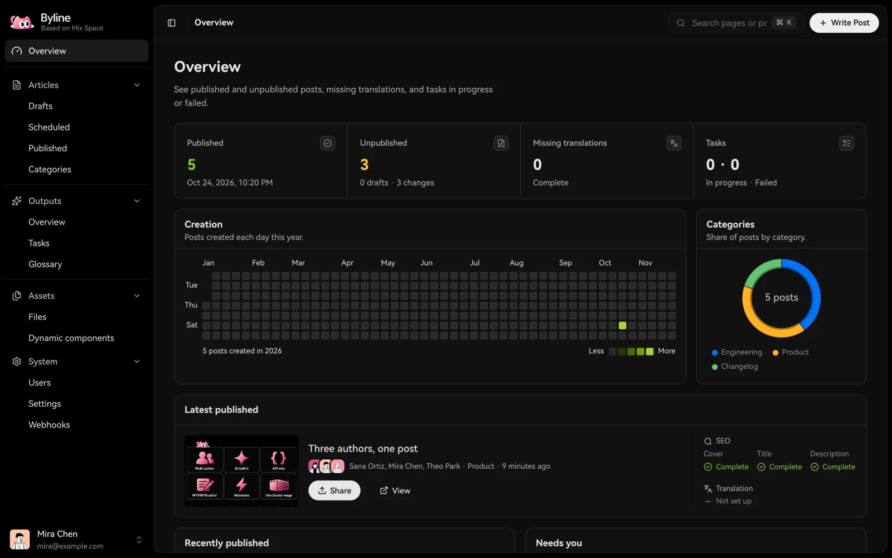</td>
    <td>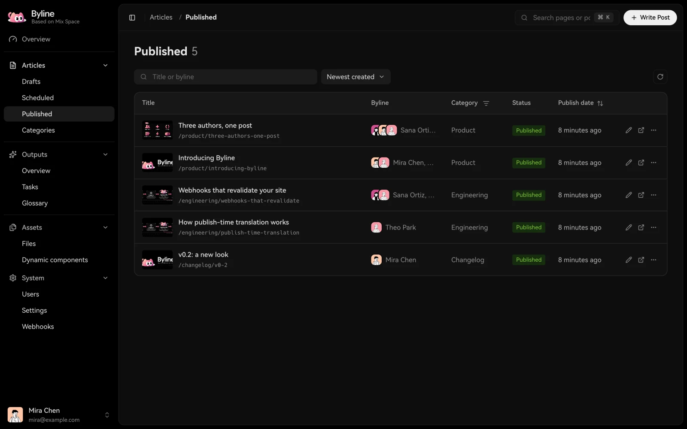</td>
  </tr>
  <tr>
    <td>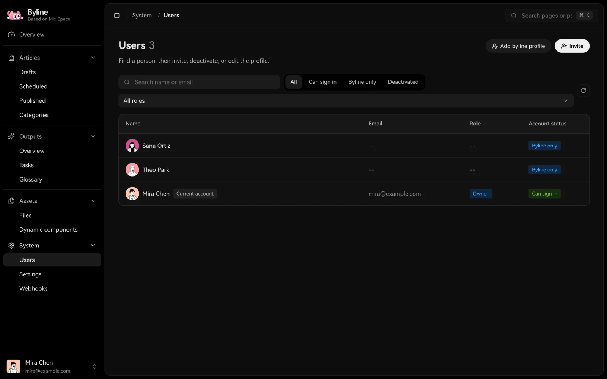</td>
    <td>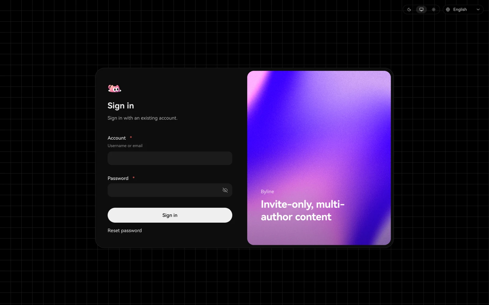</td>
  </tr>
</table>

## Develop

```sh
pnpm install && pnpm migrate && pnpm dev
```

| Read this | For |
| --- | --- |
| [`llms.txt`](./llms.txt) | Config, API, webhooks, releases |
| [`AGENTS.md`](./AGENTS.md) | Changing this repo |

[MIT](./LICENSE) © Innei
